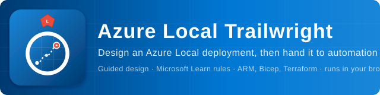

# Azure Local Trailwright



[](https://azurelocal.cloud)
[](LICENSE)

Design Azure Local deployments, validate the choices against the current release (12.2610, latest) and export files for automation. [Azure Local Surveyor](https://github.com/AzureLocal/azurelocal-surveyor) answers "does it fit"; Trailwright answers "how is it built". Neither tool deploys anything, and Trailwright never stores a secret.

**Use it now:** https://azurelocal.cloud/azurelocal-trailwright/ (runs in your browser; nothing is sent to a server).

## What you get

A guided flow (hardware, storage, network design, intents and VLANs, management network, outbound connectivity, identity, security, provisioning, Azure resources, operations) with a Microsoft Learn source for every rule, then:

| Output | For |
|---|---|
| ARM parameters (validate, deploy) and Bicep parameters | Microsoft's eight quickstart templates, contract-tested |
| `infrastructure.yml` (published [schema](apps/trailwright/public/schema/infrastructure.schema.json)) | The Azure Local Toolkit registry shape |
| Environment file and Terraform variables | The Azure Local deploy automation ([how it maps](docs/ENVIRONMENT-FILE.md)) |
| Schedules (CSV, Excel), switch port plan, topology (draw.io), handoff (Markdown, PDF), project JSON | Teams and records |
| As-built compare | Design versus what Ranger or your own script found ([format](docs/AS-BUILT.md)) |

## Prerequisites

| Need | Detail |
|---|---|
| Node.js | 22.13 or later, with npm. React 19 and Tailwind CSS 4 (@tailwindcss/postcss) come with `npm install`. |
| Browser | A current Edge, Chrome or Firefox. The app runs entirely in the browser; nothing is sent to a server and no secret is stored. |
| Tests | `npm test` needs no browser. `npm run test:browser` uses Playwright, which downloads a browser the first time. |
| Azure, PowerShell, credentials | None for Trailwright itself. To fill hardware values from the machines, run the toolkit's hardware discovery (Dell iDRAC only in this phase): PowerShell 7, the powershell-yaml module and TCP 443 to each BMC, with the BMC login as a Key Vault reference. See [docs/WHAT-TO-COLLECT.md](docs/WHAT-TO-COLLECT.md). |
| Solution Builder Extension (SBE) package | Download your hardware vendor's Solution Builder Extension package for your model and the Azure Local version you deploy. It is a requirement: you need it to update the cluster, and the automation reads it from a share and checks it before the cluster is created. Installing it during the build is optional (off by default). Trailwright asks where the package is (a share path), whether the requirement applies (required, or not applicable with a reason, for example hardware without an SBE) and whether to side-load it at build time (default no). The share credential is a Key Vault reference, never typed. Downloads differ by vendor and are not checked here; Dell AX and MC need a login-gated download. See [Solution Builder Extension updates for your Azure Local](https://learn.microsoft.com/azure/azure-local/update/solution-builder-extension). Hardware discovery does not read the package: it is not on the machines' BMC. |

## Quick start

You need Node.js 22.13 or later. The application uses React 19 and Tailwind CSS 4 with the dedicated `@tailwindcss/postcss` plugin; the JavaScript Tailwind configuration is loaded explicitly from the main stylesheet.

```powershell
git clone https://github.com/AzureLocal/azurelocal-trailwright.git
cd azurelocal-trailwright
npm install
npm run dev            # http://localhost:5173
```

Open the app, choose **Explore the example** on the landing page, and walk through the steps. Or import a plan from [Surveyor](https://github.com/AzureLocal/azurelocal-surveyor).

```powershell
npm run check          # type check
npm run lint           # ESLint
npm test               # unit and contract tests
npm run build          # contract tests, type check, production build
npm run test:browser   # Playwright journeys (builds and previews the app)
```

## Documentation

- [User guide](docs/USER-GUIDE.md)
- [What an Azure Local deployment needs, what Trailwright asks, and what hardware discovery can fill in](docs/WHAT-TO-COLLECT.md)
- [Validation rules](docs/RULES.md) (generated from the code)
- [infrastructure.yml field reference](docs/INFRASTRUCTURE-YML.md)
- [Environment file and Terraform variables](docs/ENVIRONMENT-FILE.md)
- [As-built compare](docs/AS-BUILT.md)
- [History of the rebuild](docs/HISTORY.md), [Changelog](CHANGELOG.md), [Contributing](CONTRIBUTING.md)

MIT licensed.
